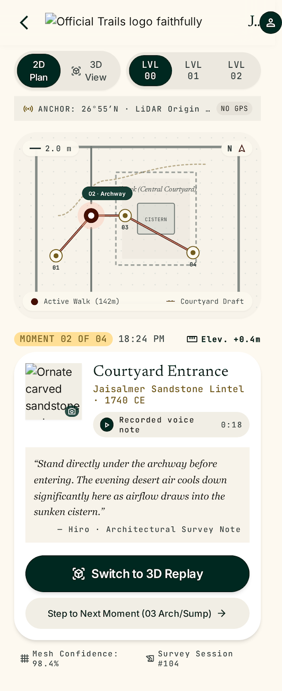
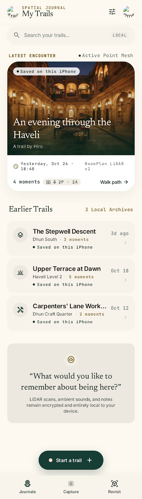
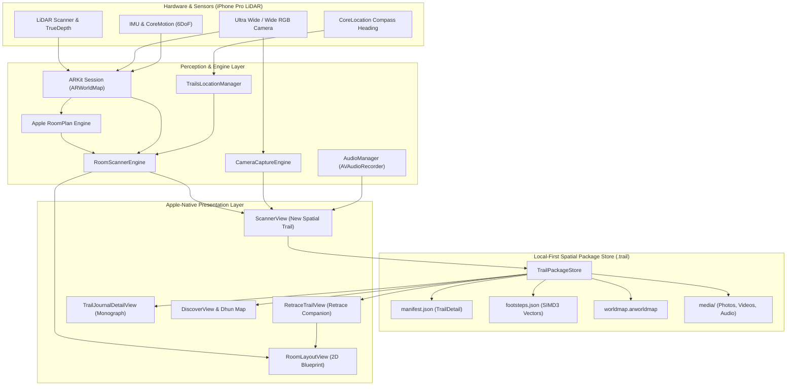
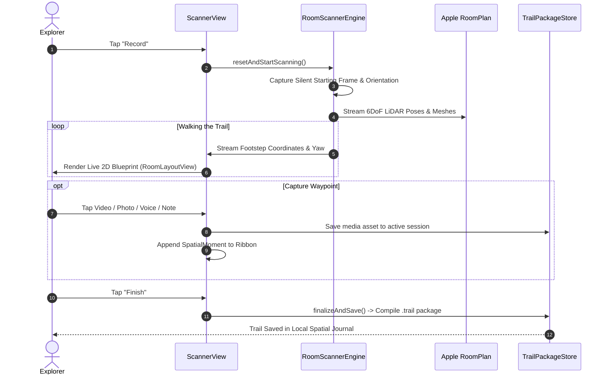
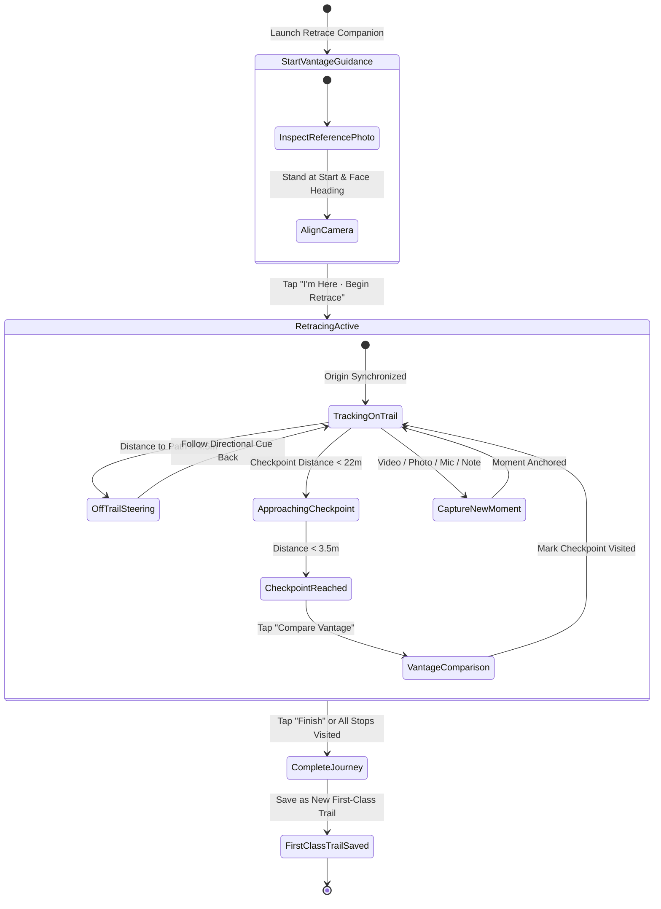
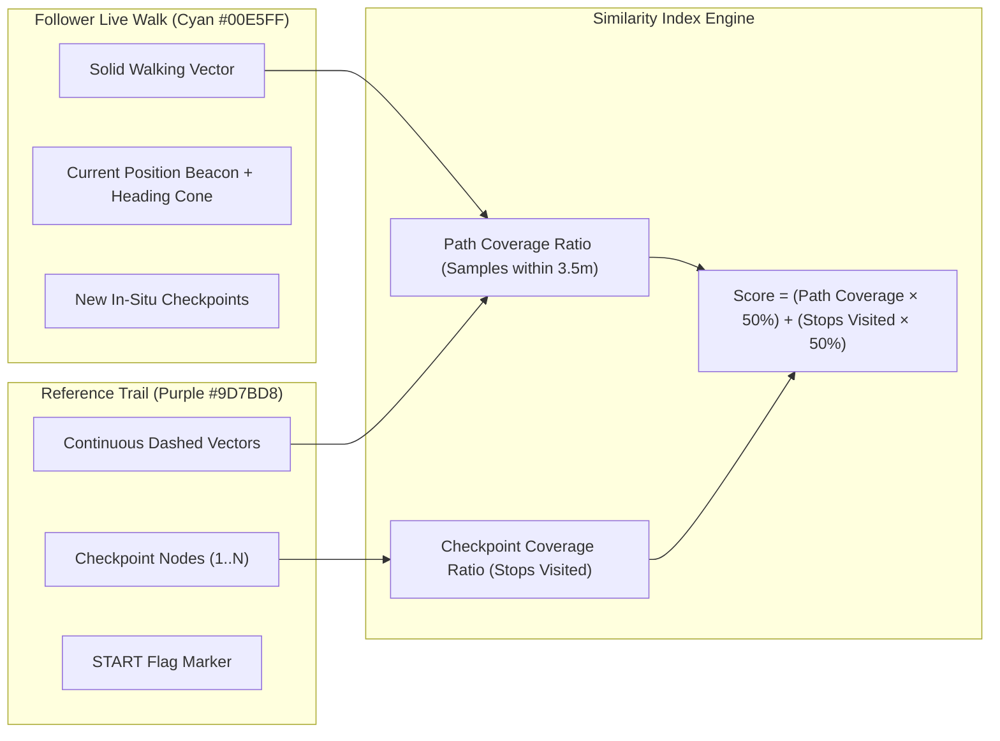

<p align="center">
  
</p>

<h1 align="center">Trails</h1>

<p align="center">
  <strong>A Living Spatial Exploration Journal for iOS</strong><br>
  Architectural LiDAR mapping, 6DoF waypoint capture, dual-path retracing, and local-first memory preservation.
</p>

<p align="center">
  
  
  
  
  
</p>

---

## Overview

**Trails** is an Apple-native spatial computing application designed for handheld architectural survey, spatial memory recording, and historical space exploration. 

Built with **Apple RoomPlan**, **ARKit 6DoF LiDAR tracking**, and an organic editorial aesthetic, Trails bridges architectural precision with the contemplative luxury of an exhibition monograph. Creators record indoor journeys with continuous footstep vectors and multi-modal waypoints; followers retrace those paths with dynamic directional turn guidance, physical starting reference alignment, and live similarity scoring.

<p align="center">
  
  &nbsp;&nbsp;
  
</p>

---

## Key Features

### 1. Spatial Recording with Live Architectural Blueprint
- **Simultaneous 6DoF Tracking & RoomPlan Meshing**: Captures walls, doors, windows, objects, and continuous footsteps without synthetic gamification.
- **Split-View Visualizer**: Upper pane displays the live LiDAR camera stream with depth cues; lower pane renders a real-time 2D architectural blueprint (`RoomLayoutView`).
- **Silent Starting Reference Frame**: Automatically captures the creator's initial vantage point and compass orientation at step zero to serve as the physical anchor for future followers.
- **Multi-Modal Waypoint Capture Dock**:
  - 🎥 **Spatial Video**: Full-screen recording anchored directly to 6DoF coordinates.
  - 📸 **High-Resolution Photo**: Rapid shutter capture with heading orientation metadata.
  - 🎙️ **Voice Notes**: In-situ audio memo recording with live waveform feedback.
  - 📝 **Field Notes**: Written architectural observations and reflections.
- **In-Capture Moments Tray**: Preview, caption, and curate recorded moments along the journey before finishing.

### 2. Dual-Path Retracing & Turn Navigation
- **Start of Trail Reference Vantage**: Displays the creator's exact starting photo and compass heading to guide the follower to the exact physical starting point.
- **Dual-Path Visual Encoding**:
  - **Original Reference Trail**: Rendered as a distinct purple dashed vector (`#9D7BD8`) with a purple `START` flag.
  - **Live Follower Walk**: Rendered in electric cyan (`#00E5FF`) with a dynamic position beacon and facing-heading cone.
- **Dynamic Directional Turn Guidance**:
  - Computes relative heading angles (`Ahead`, `Turn 90° Left/Right`, `Turn Around`).
  - Alerts the user when deviating off-trail (`X.Xm off trail · Steer toward purple path`).
  - Detects path bends ahead based on geometric curvature analysis.
- **Vantage Comparison & Checkpoint Arrival**:
  - Automatically alerts the user upon entering a checkpoint’s 3.5m spatial radius.
  - Side-by-side split sheet to inspect the creator's original vantage against the live view.
- **Live Similarity Index**:
  - Real-time scoring combining continuous path spatial coverage (within 3.5m) and visited checkpoint ratios.
- **First-Class Retraced Trails**:
  - When finished, retraced journeys are packaged and saved into the user's journal as new, independent recorded trails on their own merit, citing the original reference trail.

### 3. Local-First Spatial Packages (`.trail`)
- Completely offline, self-contained spatial archives containing `manifest.json`, footstep vectors, RoomPlan surface geometry, ARWorldMap relocalization data, and embedded media assets.
- Exportable, shareable, and zero-cloud reliant.

---

## System Architecture



---

## Core Workflows

### 1. Spatial Recording Pipeline



---

### 2. Retrace & Relocalization State Machine



---

### 3. Dual-Path Visual Encoding & Similarity Scoring



---

## Design System & Editorial Palette

Trails is styled around **Modern Architectural Minimalism** combined with **Apple-native Tactility**. High-contrast mineral materials guarantee readability between bright ambient sunlight and dim architectural atriums.

| Material / Role | Hex Code | Visual Swatch | Purpose |
| :--- | :---: | :---: | :--- |
| **Limestone Canvas** | `#F5F1E8` | `rgb(245, 241, 232)` | Base paperboard background and floorplan ground |
| **Forest Green** | `#173E35` | `rgb(23, 62, 53)` | Structural chrome, primary CTA buttons, navigation accents |
| **Terracotta** | `#C66B4E` | `rgb(198, 107, 78)` | Active journey vector, active waypoints, primary recording |
| **Muted Brass** | `#B59A58` | `rgb(181, 154, 88)` | Checkpoint moment pins, compass arrows, architectural nodes |
| **Deep Ink** | `#202923` | `rgb(32, 41, 35)` | High-legibility editorial titles and primary typography |
| **Original Reference Path** | `#9D7BD8` | `rgb(157, 123, 216)` | Reference trail dashed vectors and start marker in Retrace |
| **Follower Retrace Path** | `#00E5FF` | `rgb(0, 229, 255)` | Live retrace vector, active navigation cues, match badge |

### Typography Hierarchy
- **Curatorial Editorial (`Newsreader`)**: Expressive, literary serif used for place monographs, space titles, and exhibition narrative reflections.
- **System Interface (`Inter`)**: Clean, ergonomic sans-serif for interactive sheets, buttons, list views, and HUD commands.
- **Survey Coordinates (`JetBrains Mono`)**: Strict, tabular monospace for LiDAR dimensions, coordinates, elevation offsets (`+14.2M`), compass headings (`45° NE`), and timer telemetry.

---

## Local Package Architecture (`.trail`)

Every trail in Trails is packaged as a completely self-contained folder structure:

```
<trailId>.trail/
├── manifest.json                  # TrailDetail metadata, author, place, moments array
├── footsteps.json                 # Array of SIMD3<Float> continuous 6DoF position vectors
├── spatial/
│   ├── worldmap.arworldmap        # Serialized ARKit ARWorldMap for coordinate relocalization
│   └── room_mesh.usdz             # 3D volumetric RoomPlan mesh
└── media/
    ├── start_frame.jpg            # Starting reference photo for retrace physical alignment
    ├── photo_<uuid>.jpg           # High-resolution checkpoint photos
    ├── video_<uuid>.mp4           # Spatial video recordings
    ├── thumb_<uuid>.jpg           # Video thumbnail previews
    └── voice_<uuid>.m4a           # AAC voice note observations
```

---

## Project Structure

```
trails/
├── docs/                          # Architecture PRDs, stitch design specs, brand assets
│   ├── prd/                       # Evolution PRDs (v0.1.0 through v0.4.0)
│   ├── stitch/                    # Design mockups, screen tokens, typography specs
│   └── logo.png                   # Official Trails brand mark
├── ios/                           # Native iOS Xcode Project & Swift Sources
│   ├── Sources/
│   │   ├── App/                   # App lifecycle (TrailsApp.swift), configurations
│   │   ├── Scanner/               # RoomPlan LiDAR engines, HUDs, camera & layout
│   │   │   ├── Managers/          # RoomScannerEngine, CameraCaptureEngine
│   │   │   └── Views/             # ScannerView, RoomLayoutView, FullScreenCapture
│   │   ├── Trails/                # Domain models, data stores, retrace flows
│   │   │   ├── Models/            # TrailModels, TrailsDataStore, ReferenceFrame
│   │   │   ├── Services/          # TrailPackageStore, AudioManager, LocationManager
│   │   │   └── Views/             # RetraceTrailView, TrailJournalDetailView, MyTrailsView
│   │   ├── TabBar/                # Main navigation (My Trails, Discover, Record, You)
│   │   └── UI/                    # AppColors, AppFonts, Haptics, common components
│   └── Trails.xcodeproj           # Xcode project definition
├── scripts/                       # Device deployment & runner automation (Bun/TypeScript)
│   └── ios-device.ts              # Command-line device detection, install, and logs
├── justfile                       # Project task runner
└── Taskfile.yml                   # Task runner configuration
```

---

## Getting Started

### Prerequisites
- **Hardware**: Mac running macOS Sonoma or Sequoia with Xcode 15+ / 16+.
- **Target Device**: iPhone 12 Pro or newer with LiDAR Scanner (iPhone 12/13/14/15/16 Pro or Pro Max).
- **Tooling**:
  - [Just](https://github.com/casey/just) command runner (`brew install just`)
  - [Bun](https://bun.sh) runtime (`brew install oven-sh/bun/bun`)

### Quick Commands

```bash
# List connected physical iOS devices
just ios-devices

# Build and deploy to your connected physical iPhone
just ios

# Non-waiting install handoff (ideal for background agent loops)
just ios-agent

# Build and run UI test suite
just ios-test

# Launch on iOS Simulator
just ios-simulator simulator="iPhone 15 Pro"

# Open directly in Xcode
just ios-open
```

### Environment Configuration (`.env`)
Create a `.env` file in the repo root to set your target device:

```env
IOS_DEVICE=00008101-001224822130001E
IOS_CONFIGURATION=Debug
IOS_DERIVED_DATA=build/ios/DerivedData
IOS_SOURCE_PACKAGES_DIR=build/ios/DerivedData/SourcePackages
IOS_RESET_SOURCE_PACKAGES=false
```

---

## PRD Evolution Milestones

- **v0.1.0 — Core Spatial Capture**: Initial RoomPlan LiDAR scan integration, basic step tracking, and local JSON persistence.
- **v0.2.0 — A Living Spatial Journal**: Introduced the monograph editorial aesthetic (Limestone, Terracotta, Forest Green), multi-level architectural floor filtering, and places taxonomy.
- **v0.2.1 — Waypoint Capture Dock & In-Situ Curating**: Added full-screen spatial video, photos, audio memos, and the interactive moments tray dock.
- **v0.3.0 & v0.3.1 — Reliable Reference Frames & Dual-Path Retrace**: Solved small-space coordinate drift through silent initial reference frame capture, physical starting vantage guidance, real-time directional turn cues, and similarity index scoring.
- **v0.4.0 — First-Class Retraces & Discover Catalogue**: Elevated retraced trails into independent first-class journal entries, added author attribution, and introduced community place discovery.

---

<p align="center">
  Crafted with care for architects, historians, spatial thinkers, and curious explorers.
</p>
